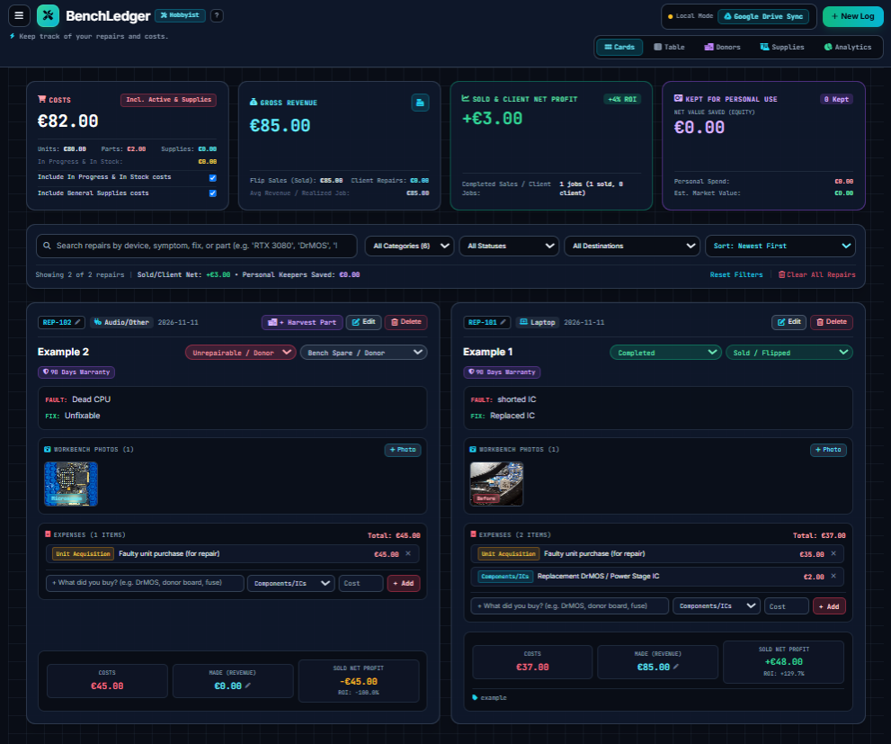

# BenchLedger 

BenchLedger is a 100% serverless, local-first web application designed for electronics repair technicians, flippers, and weekend tinkerers to track repair tickets, part costs, and donor boards.

I originally built this tool to replace my messy spreadsheets and to properly separate my flip profits from the gear I occasionally decide to keep for myself.

##  100% Private & Serverless Architecture
BenchLedger operates with **zero external database servers**. 
* **Local Mode:** By default, all data, financial metrics, and compressed inspection photos are stored entirely inside your browser's local cache (`IndexedDB`). 
* **Bring-Your-Own-Storage (BYOS):** You can optionally connect your personal Google Drive. The app will sync your workbench to a private `BenchLedger_Sync` folder in your own Drive. The app uses the restricted `drive.file` scope, meaning it can only access the exact files it creates. Nobody else (including the developer) can see your data.

##  Key Features
* **Hobbyist & Pro Shop Modes:** Toggle between a layout focused on personal/flip equity, or a commercial layout featuring a CRM, client management, and printable service receipts.
* **Donor Boneyard:** Catalog harvested ICs, MOSFETs, and connectors from dead boards. Deploy them to active repair tickets at €0 out-of-pocket cost.
* **General Supplies Tracking:** Log your flux, IPA, and solder wire purchases and automatically apply the overhead to your bottom-line profit.
* **Cookieless Analytics:** The live site uses a privacy-preserving counter (Umami) to track overall traffic without setting tracking cookies or logging personal IP addresses. 

## License & Copyright
© 2026 BenchLedger. All Rights Reserved.

This application is provided free for personal and workshop use. The source code is publicly visible for transparency and hosting purposes only. You may not copy, redistribute, white-label, or monetize this code as a commercial product without explicit permission.
